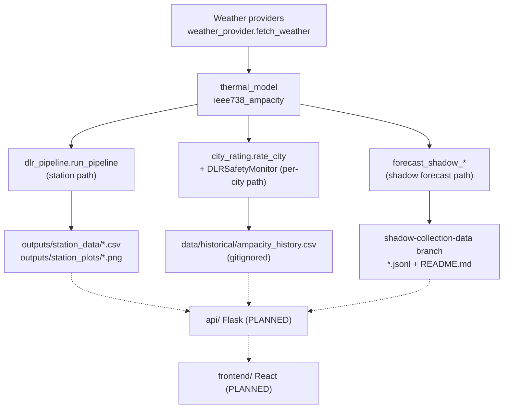

<!-- generated-by: gsd-doc-writer -->
# Architecture

This guide is for the Software sub-team building the React dashboard (`frontend/`) and the Flask API (`api/`) on top of the Python data science (DS) backend in `backend/`. It explains how data moves from the backend to flat files under `outputs/` and `data/`, and where the planned `api/` and `frontend/` layers will attach.

**Status legend used throughout:**

- **Built** means the code exists in the repo today.
- **PLANNED** means nothing exists yet. `frontend/README.md` and `api/README.md` are structural placeholders with no code, no `package.json`, and no Flask app.
- **Per-city** means the behavior is defined by `docs/data-science/decisions/point_scope.md` (adopted 2026-10-12) and implemented in the backend: `backend/city_point.py`, `backend/city_rating.py` (`rate_city`) and the per-city shadow pipeline (`schema_version: 3`) were read for this guide on 2026-10-12.

## System overview

The Dynamic Line Rating (DLR) system turns live weather and grid data into a conductor ampacity (amps) for each of four cities (`AUSTIN`, `CORPUS_CHRISTI`, `MIDLAND`, `EL_PASO`). Each city is one independent rating point: there is no corridor, no pairing of cities, and no minimum or bottleneck across cities. It compares that ampacity against a conservative static line rating (SLR) and falls back to the static rating when the inputs cannot be trusted. `docs/System Design Report.md` describes three layers: Input Data, Analysis & Modeling, and Output. The DS backend implements the first two as a batch-oriented Python pipeline. The Output layer, the operator dashboard, is the Software sub-team's deliverable.

There is no server, message bus, or database in the repo today. The backend communicates with the outside world through files:

- **CSV and PNG files** written to `outputs/` by the station pipeline.
- **An append-only CSV archive** at `data/historical/ampacity_history.csv` (`config.HISTORICAL_ARCHIVE_PATH`) written when a rating is archived. In the current code its `corridor` column is now `city`, and `bottleneck_index` is retained but always null for per-city rows (the scope contract does not specify archive columns).
- **JSONL prediction logs** and a rendered Markdown table written by the shadow forecast collector, which runs on GitHub Actions.

The planned `api/` layer would read those artifacts, or call the Python code directly, and serve them to the planned `frontend/`.

## Component diagram

Arrows show the direction data flows. Dashed boxes and arrows are PLANNED.



## Data flow

The backend has three independent entry points (the second is now per city). They share the weather adapter and the IEEE 738 thermal model but write to different places.

### 1. Station path: per-station DLR to CSV and PNG (built)

This is the path with a published contract, and the one you can build against today.

1. `backend/dlr_pipeline.py::run_pipeline(stids, start, end, conductor, city, solar_alt_deg)` calls `fetch_timeseries`. That function pulls 5-minute observations from the Synoptic API (West Texas Mesonet stations). It needs `SYNOPTIC_TOKEN`; see [configuration.md](configuration.md).
2. It drops rows missing `air_temp`, `wind_speed`, or `wind_direction`, and fills missing solar radiation with 1000 W/m².
3. `thermal_model.perpendicular_wind` projects wind onto the line azimuth, producing `wind_perp_ms`.
4. `thermal_model.ieee738_ampacity` computes `dlr_amps` from the IEEE 738 heat balance.
5. Headroom against the per-city static rating is computed: `dlr_headroom_pct` and `dlr_uplift_flag`. The rating comes from `config.STATIC_RATINGS`, with `config.DEFAULT_STATIC_RATING` (900 A) for an unknown or omitted city.
6. `validate_pipeline_output` checks each row against `units_def.PIPELINE_SCHEMA`. It logs violations but never drops rows.
7. `export_results` writes one CSV per station to `outputs/station_data/{file_prefix}_{stid}.csv`. `plot_dlr_summary` writes a 4-panel PNG per station to `outputs/station_plots/`.

The CSV columns are exactly the following, in this order. This is documented in [`docs/data-science/schema/pipeline_output_v1.md`](../../data-science/schema/pipeline_output_v1.md):

`stid, datetime_utc, air_temp, wind_speed, wind_direction, wind_perp_ms, solar_radiation, relative_humidity, dlr_amps, dlr_headroom_pct, dlr_uplift_flag`

Optional second stage (built): `backend/ercot_dlr_merger.py::process_dlr_to_hourly` reads one station CSV, resamples to hourly worst case (`min` of `dlr_amps`), and adds `dlr_capacity_mw` and `static_capacity_mw` via `amps_to_mw` (using `config.LINE_VOLTAGE_KV` and `config.POWER_FACTOR`). `load_ercot_west_data` then joins ERCOT West load. Its `__main__` block writes `merged_ercot_dlr_{station}.csv` and `holistic_view_{station}.png` to the current working directory. The checked-in examples are `outputs/merged_ercot_dlr_AN489.csv` and `outputs/holistic_view_AN489.png`. The MW columns are not in the station CSV, so a dashboard that wants MW must either run this merge step or convert amps itself.

### 2. Per-city path: gated rating of one city point (per-city contract, no file feed)

This is the path closest to what the dashboard is meant to show (fallback status, alerts). It replaces the retired corridor path (`corridor_discretization.rate_corridor`, `corridor_pipeline.run_corridor_pipeline`), which discretized a corridor into points and reduced them with `min()`. The per-city path returns Python objects and does not export a file.

1. `city_point.city_point(city)` resolves a city (a key of `config.LOCATIONS`) into a `CityPoint`: coordinate (`config.CITY_COORDINATES`), static rating (`config.STATIC_RATINGS`), plausibility bounds (`config.RATING_BOUNDS_BY_LOCATION`) and line bearing (`config.CITY_LINE_BEARING_DEG`). An unknown city raises `KeyError` naming the valid cities. The bearings are an **assumption** carried over from the retired corridor bearings (Austin and Corpus Christi 173.15 degrees, Midland and El Paso 267.54 degrees), not a measured line orientation.
2. `backend/city_rating.py::rate_city(city, start, end, stations, ..., provider="synoptic")` resolves the city's nearest usable station observation, keeping the old probe-and-fallback behavior, or a grid fetch for the `open_meteo` and `nsrdb` providers via `weather_provider.fetch_weather`.
3. The observation passes through `backend/DLRSafetyMonitor.py::DLRSafetyMonitor.run_check` with the city's own static rating. It applies gates G1 to G6: sensor availability, link, range, plausibility, delta check, and the learned anomaly check from `anomaly_detector.AnomalyDetector`. A failed gate returns the static rating with `fallback: True` and an alert string (G5 reports `min(computed, static)`). A city whose candidate stations are all unusable resolves to the static rating with an alert.
4. `rate_city` returns one dict per city with keys `city`, `point` (a `(lat, lon)` tuple), `station_id` (`None` when exhausted), `candidates_probed`, `probe_trail`, `rating`, `status`, `fallback`, `alerts`, `observation` (`None` when exhausted), `exhausted` (bool) and `archived`. There is no `points` list, `bottleneck_index` or `exhausted_points` count.
   - `DLRSafetyMonitor.run_check` itself returns `{status, rating, fallback, alerts}`, where `status` is `"ok"` or `"fallback"`.
5. Optionally, one row is archived per call by `historical_archive.append_observation`. That file is gitignored. In the code read for this guide, `historical_archive.ARCHIVE_COLUMNS` is `datetime_utc, city, air_temp, wind_speed, solar_radiation, dlr_amps, static_rating, status, fallback, bottleneck_index, schema_version`: `corridor` became `city`, `bottleneck_index` is kept only for shape compatibility and written as null, and `schema_version` is still 1. Corridor-era archive files (header has `corridor`) remain readable. The scope contract itself does not specify archive columns, so treat this as current code, not a decided contract.

The forecast (`ampacity_forecast.forecast_ampacity`, then `forecast_columns`) produces `forecast_horizon_min`, `forecast_amps`, `forecast_ci_lower_amps`, and `forecast_ci_upper_amps`. The forecast is used only to build the anomaly detector and does not appear in the returned dict or in any exported file. Anomaly and forecast model artifacts are per city (`forecast_{city}.joblib`, `anomaly_{city}.joblib`); corridor-named artifacts are legacy and not loaded, and per-city models were fit locally on 2026-10-13 but are git-ignored. `run_pipeline` (the station path) never calls forecasting, per-city rating, or anomaly detection. `docs/data-science/PROJECT-STATUS.md` tracks this integration as open work.

### 3. Shadow forecast collector: day-ahead predictions to JSONL (built, experimental)

This is the only path that runs unattended and produces a continuously growing feed. It is explicitly experimental and is never invoked by the production pipeline; see [`docs/data-science/decisions/shadow_collection_runbook.md`](../../data-science/decisions/shadow_collection_runbook.md).

1. `.github/workflows/shadow_collect.yml` ("Shadow Collection") runs four times a day at 00:00, 06:00, 12:00 and 18:00 UTC (`cron: '0 0,6,12,18 * * *'`) and on manual dispatch.
2. It runs `backend/forecast_shadow_collect.py::collect_once`, which iterates `config.LOCATIONS` (the four cities, one child process per city, with an inter-city request delay) and calls `forecast_shadow_demo.run_once_all_methods` for each city.
3. That function fetches the live Open-Meteo forecast (underlying weather model `config.SHADOW_LIVE_FORECAST_MODEL`, currently `gfs_seamless`, up to 3 attempts on transport errors) and the observed anchor wind once per city (`forecast_shadow_pipeline.fetch_shared_city_inputs`, formerly `fetch_shared_corridor_inputs`). It then computes five candidates, named in `forecast_shadow_pipeline.CANDIDATE_METHOD_NAMES`: `ml_wind_corrected`, `ml_cooling_corrected`, `raw_forecast`, `persistence_24h`, `reference_ml_refit_24h`.
4. `forecast_shadow_pipeline.log_cycle_predictions` appends one JSON line per city per cycle to `data/shadow/predictions/{CITY}.jsonl`, with `schema_version: 3`.
5. The workflow appends those lines to the same path on the `shadow-collection-data` branch, and runs `backend/forecast_shadow_render_table.py` to regenerate that branch's root `README.md` table. It then pushes the branch.

Three record shapes can exist on disk. A reader must handle all of them:

- **`schema_version: 3` (per city, current):** one file per city. Records carry `city` where earlier records carried `corridor`. The scope contract states that every per-city method now targets that city's own ampacity rather than a minimum, and that nothing reduces across cities; it does not publish the full v3 field list. The candidate names are expected to continue (`ml_wind_corrected`, `ml_cooling_corrected`, `raw_forecast`, `persistence_24h`, `reference_ml_refit_24h`), but the v3 shape of `candidates.*.bundle` and `input_provenance` is **not final**: the corridor-era `corridor_bundle_ampacity_amps`, `bundle_bottleneck_city`, `endpoint_bundle_ampacity_amps` and `per_city_ampacity_amps` pooling are among what the contract removes. Do not code against the v2 shapes for v3 rows; confirm with DS.
- **`schema_version: 2` (corridor-era, legacy):** `corridor`, `initialization_time`, `availability_time`, `decision_time`, `valid_time`, `logged_at`, `basis_caveat`, `horizon_minutes`, a `candidates` object (each candidate has `status`, `ampacity_amps`, `fallback_used`, `fallback_reason`, `model_version`, `input_provenance`, `reason`, `bundle`) and a top-level mirror of `ml_wind_corrected`.
- **Flat rows (corridor-era v1, legacy):** rows written before 2026-10-07 have a single-candidate shape and no `schema_version` or `candidates` keys.

`AUSTIN_CORPUS_CHRISTI.jsonl` and `MIDLAND_EL_PASO.jsonl` are the legacy corridor files: they are left untouched, hold v1 flat and v2 rows, and must not be mixed into per-city views. Per-city logs start empty, and until the per-city shadow models are refit the ML candidates report `status="unavailable"` with a named reason. Any parser must tolerate legacy files, as `forecast_shadow_render_table.py` and `forecast_shadow_healthcheck.py` do for the older row shapes (whether they have been updated for v3 was not checked).

The v2 `bundle` object reported ampacity scaled by subconductors per phase (`config.SUBCONDUCTORS_PER_PHASE`, a provisional assumption from the Power Systems sub-team). The per-conductor `ampacity_amps` is unchanged. Decide deliberately which of the two the dashboard shows, and label it.

## Key abstractions

| Abstraction | Location | Role |
|---|---|---|
| `PIPELINE_SCHEMA`, `PIPELINE_SCHEMA_VERSION` | `backend/units_def.py` | Canonical column names, units, and valid ranges. Version 3 in code, additive-only. |
| `validate_pipeline_row` | `backend/units_def.py` | Row-level contract check used by `dlr_pipeline.validate_pipeline_output` and the archive. |
| `ConductorConfig`, `ieee738_ampacity` | `backend/thermal_model.py` | IEEE 738 heat-balance model; the source of every amps value. |
| `fetch_weather` | `backend/weather_provider.py` | Provider-agnostic weather adapter (TCEQ, ASOS, NSRDB, Open-Meteo, with Synoptic as automatic fallback). Used by the per-city path. |
| `DLRSafetyMonitor` | `backend/DLRSafetyMonitor.py` | Six fail-safe gates. Source of `status`, `fallback`, and `alerts`. |
| `CityPoint`, `city_point` | `backend/city_point.py` | A city's resolved rating point: coordinate, line bearing, conductor, its own static rating and bounds. Closed-set guard for city keys. Replaces `corridor_geometry`. |
| `rate_city` | `backend/city_rating.py` | Per-city rating dict (rating, status, fallback, alerts, observation). Replaces `rate_corridor`. |
| `AnomalyDetector` | `backend/anomaly_detector.py` | Learned G6 signal: a threshold check on history and forecast residuals, plus an optional fitted scikit-learn outlier model loaded per city (`anomaly_{city}.joblib`) when one is provisioned; corridor-named artifacts are legacy and not loaded. |
| `ForecastResult`, `forecast_ampacity`, `forecast_columns` | `backend/ampacity_forecast.py` | Point forecast with a confidence interval, mapped to four schema columns. |
| `ShadowPrediction`, `ShadowPipeline`, `log_cycle_predictions` | `backend/forecast_shadow_pipeline.py` | Candidate result type and the JSONL writer. |
| `config` | `backend/config.py` | Static ratings, city list (`LOCATIONS`), city coordinates and line bearings, conductor defaults, archive path. `LEGACY_CORRIDOR_ENDPOINTS` exists only for the frozen 2026 forecast-correction experiment and is not for dashboard use. |

## Directory structure rationale

```
backend/    Python DS subsystem: ingestion, thermal model, safety monitor,
            forecasting, shadow collector. Tests in backend/tests/.
api/        PLANNED Flask layer (placeholder README only).
frontend/   PLANNED React dashboard (placeholder README only).
data/       Checked-in reference inputs: station metadata, shadow models
            (data/shadow/models/), and the sample fixture
            (data/fixtures/sample_pipeline_output.csv). Generated subfolders
            (historical/, models/, experiment/, shadow/predictions/) are gitignored.
outputs/    Generated pipeline output (gitignored). Not available in a fresh clone.
docs/       data-science/ (PRD, roadmap, specs, schema, decisions) and
            frontend/ (see `docs/frontend/PRD.md`, `ROADMAP.md`, and `specs/`).
.github/    workflows/shadow_collect.yml, the only CI workflow.
```

The backend is organized as flat Python modules with a shared `config.py` and `units_def.py`, and is run with `PYTHONPATH=backend` (modules import each other by bare name). The DS team keeps requirements, roadmap, and per-component specs in `docs/data-science/`, and `docs/frontend/README.md` asks the Software team to mirror that convention for its own subsystem.

## Where the planned layers attach

### What exists to build against today

- **Sample data without credentials:** `data/fixtures/sample_pipeline_output.csv` has 10 rows for one station at 5-minute cadence and matches `pipeline_output_v1.md`. It was designed so the dashboard can be built and tested without running the pipeline or holding a Synoptic token.
- **Shadow predictions:** the `shadow-collection-data` branch on `origin`. Retrieve a log with `git fetch origin shadow-collection-data` followed by `git show shadow-collection-data:data/shadow/predictions/AUSTIN.jsonl` (a per-city file). Per-city logs began empty on 2026-10-12, so a given file may not exist or may have no rows until the collector has run under the per-city model; the corridor-named files are legacy. Whether the repo is readable without authentication for a raw-file HTTP fetch is not documented. <!-- VERIFY: repository visibility and whether raw.githubusercontent.com access to the shadow-collection-data branch is permitted -->

### `api/` (PLANNED)

`api/README.md` states the stack is Flask and the design is undecided: a thin file-serving layer, a live-polling service, or one that also proxies PSS/E outputs. The real files an API could read, and their contracts, are:

| Source | Contract | Stability |
|---|---|---|
| `outputs/station_data/*.csv` | `pipeline_output_v1.md` (11 columns) | Versioned doc; filenames carry no version. |
| `data/historical/ampacity_history.csv` | `historical_archive.ARCHIVE_COLUMNS`, `schema_version` column | Locked column list: `city` replaces `corridor`; `bottleneck_index` is retained but null for per-city rows (current code; not in the scope contract). |
| `rate_city` return dict | `city_rating.rate_city` (per-city contract) | In-process only; requires importing Python code. |
| `data/shadow/predictions/{CITY}.jsonl` | `log_cycle_predictions` (schema v3; legacy v2 and flat rows in the corridor-named files) | Experimental; may change; v3 field list not final. |

### `frontend/` (PLANNED)

Per `docs/Project Definition.md` and `docs/System Design Report.md` (WBS 4.1 and 4.2), the dashboard is planned to show:

- Dynamic vs. static capacity (DLR vs. SLR).
- A forecast panel.
- Anomaly and fallback status indicators.
- Current weather conditions.
- A selection of preset locations.

The System Design Report also lists connecting PSS/E simulation outputs to the dashboard (WBS 4.2.2).

## Gaps the Software team should know about

These follow from reading the code and specs. Confirm each with the DS team before designing around it.

- **No trusted-duration value.** The Project Definition and `PRD.md` list a "trusted-duration window" as a dashboard output. Nothing in `backend/` computes one.
- **Per-city results are not exported.** Each city's status, alerts and fallback exist only in the dict returned by `rate_city` (plus an optional archive row). There is no file or endpoint carrying them. There is also no corridor-level rating, minimum or bottleneck to export: the project no longer has them. This is the main decision for `api/`: call Python in-process, or ask DS to add an exporter.
- **Forecast is not in any file feed.** The four `forecast_*` columns exist in `PIPELINE_SCHEMA` but `export_results` does not write them. The shadow JSONL (one file per city) carries day-ahead (`horizon_minutes` = 1440, but actual decision-to-valid lead is about 11–17 h; see api-contract.md) `ampacity_amps` per candidate, which is a separate experimental forecast.
- **No scheduler for the station or per-city pipelines.** Only the shadow collector runs on a schedule. A "live" dashboard on `outputs/` needs someone to run `run_pipeline` or `rate_city` periodically.
- **Silently dropped stations.** A requested station that returns zero rows is absent from the output with no warning (see Known Issues in `docs/data-science/specs/C3-export-visualization.md`).
- **Schema versioning.** The export has no `schema_version` column or versioned filename. The open question is tracked in the C3 spec.
- **PSS/E interface undefined.** The handoff format with Power Systems is deliberately unspecified; see `docs/data-science/decisions/pss_e_handoff.md`.
- **Static ratings are placeholders.** `config.STATIC_RATINGS` values are per-conductor amps derived from owner-supplied bundle averages (2026-10-13), not confirmed line ratings. Present them as such. The shadow README carries the same caveat. A city now uses its own entry, not the minimum of a corridor pair (Corpus Christi 1500 A per conductor, was 1900 A).
- **Line bearings are assumed.** `config.CITY_LINE_BEARING_DEG` is carried over from the retired corridor bearings and drives the perpendicular-wind component. It is not a measured line orientation (`point_scope.md`, open question).
- **Per-city models are fit locally only.** The per-city "ml" forecast and anomaly models were retrained on 2026-10-13 but live in git-ignored `data/models/`, so a clean checkout has none and ML candidates there report `unavailable`. The 12 shadow correction artifacts in `data/shadow/models/` are committed.
- **Timezones.** Backend timestamps are UTC (`datetime_utc`, and `*_time` fields in JSONL). The merger adds a local-time column (`datetime_local`, Central time in the checked-in example). Display conversions are a frontend concern.

## Related docs

- [configuration.md](configuration.md) for environment variables, tokens, and file locations.
- `docs/data-science/specs/README.md` for the component spec index (C1 to C10).
- `docs/data-science/ROADMAP.md` for the DS phase order and the Software-team unblock path.
- `docs/frontend/README.md` for the PRD, roadmap, and spec convention the Software team is asked to follow.
