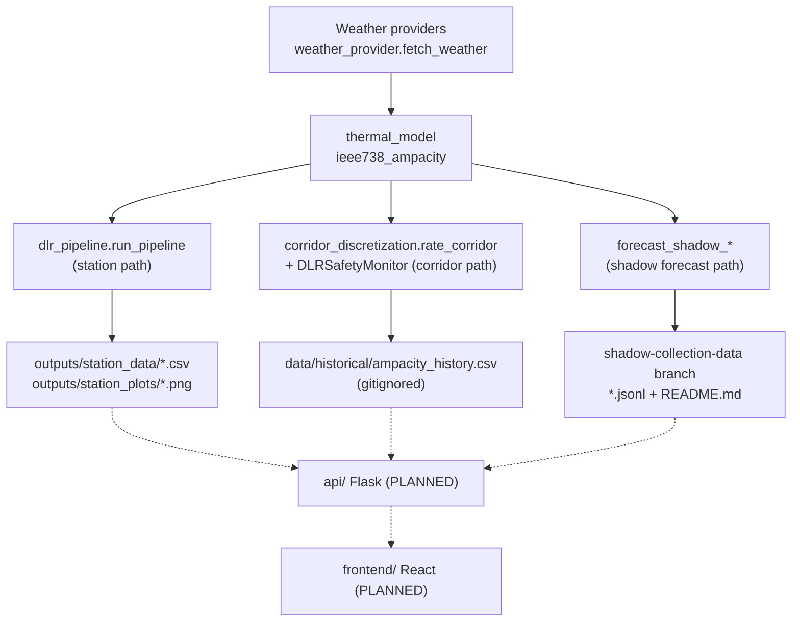

<!-- generated-by: gsd-doc-writer -->
# Architecture

This guide is for the Software sub-team building the React dashboard (`frontend/`) and the Flask API (`api/`) on top of the Python data science (DS) backend in `backend/`. It explains how data moves from the backend to flat files under `outputs/` and `data/`, and where the planned `api/` and `frontend/` layers will attach.

**Status legend used throughout:**

- **Built** means the code exists in the repo today.
- **PLANNED** means nothing exists yet. `frontend/README.md` and `api/README.md` are structural placeholders with no code, no `package.json`, and no Flask app.

## System overview

The Dynamic Line Rating (DLR) system turns live weather and grid data into a conductor ampacity (amps) per transmission corridor. It compares that ampacity against a conservative static line rating (SLR) and falls back to the static rating when the inputs cannot be trusted. `docs/System Design Report.md` describes three layers: Input Data, Analysis & Modeling, and Output. The DS backend implements the first two as a batch-oriented Python pipeline. The Output layer, the operator dashboard, is the Software sub-team's deliverable.

There is no server, message bus, or database in the repo today. The backend communicates with the outside world through files:

- **CSV and PNG files** written to `outputs/` by the station pipeline.
- **An append-only CSV archive** at `data/historical/ampacity_history.csv` (`config.HISTORICAL_ARCHIVE_PATH`) written by the corridor pipeline.
- **JSONL prediction logs** and a rendered Markdown table written by the shadow forecast collector, which runs on GitHub Actions.

The planned `api/` layer would read those artifacts, or call the Python code directly, and serve them to the planned `frontend/`.

## Component diagram

Arrows show the direction data flows. Dashed boxes and arrows are PLANNED.



## Data flow

The backend has three independent entry points. They share the weather adapter and the IEEE 738 thermal model but write to different places.

### 1. Station path: per-station DLR to CSV and PNG (built)

This is the path with a published contract, and the one you can build against today.

1. `backend/dlr_pipeline.py::run_pipeline(stids, start, end, conductor, city, solar_alt_deg)` calls `fetch_timeseries`. That function pulls 5-minute observations from the Synoptic API (West Texas Mesonet stations). It needs `SYNOPTIC_TOKEN`; see [configuration.md](configuration.md).
2. It drops rows missing `air_temp`, `wind_speed`, or `wind_direction`, and fills missing solar radiation with 1000 W/m².
3. `thermal_model.perpendicular_wind` projects wind onto the line azimuth, producing `wind_perp_ms`.
4. `thermal_model.ieee738_ampacity` computes `dlr_amps` from the IEEE 738 heat balance.
5. Headroom against the per-city static rating is computed: `dlr_headroom_pct` and `dlr_uplift_flag`. The rating comes from `config.STATIC_RATINGS`, with `config.DEFAULT_STATIC_RATING` (900 A) for an unknown or omitted city.
6. `validate_pipeline_output` checks each row against `units_def.PIPELINE_SCHEMA`. It logs violations but never drops rows.
7. `export_results` writes one CSV per station to `outputs/station_data/{file_prefix}_{stid}.csv`. `plot_dlr_summary` writes a 4-panel PNG per station to `outputs/station_plots/`.

The CSV columns are exactly the following, in this order. This is documented in [`docs/data-science/schema/pipeline_output_v1.md`](../../data-science/schema/pipeline_output_v1.md):

`stid, datetime_utc, air_temp, wind_speed, wind_direction, wind_perp_ms, solar_radiation, relative_humidity, dlr_amps, dlr_headroom_pct, dlr_uplift_flag`

Optional second stage (built): `backend/ercot_dlr_merger.py::process_dlr_to_hourly` reads one station CSV, resamples to hourly worst case (`min` of `dlr_amps`), and adds `dlr_capacity_mw` and `static_capacity_mw` via `amps_to_mw` (using `config.LINE_VOLTAGE_KV` and `config.POWER_FACTOR`). `load_ercot_west_data` then joins ERCOT West load. Its `__main__` block writes `merged_ercot_dlr_{station}.csv` and `holistic_view_{station}.png` to the current working directory. The checked-in examples are `outputs/merged_ercot_dlr_AN489.csv` and `outputs/holistic_view_AN489.png`. The MW columns are not in the station CSV, so a dashboard that wants MW must either run this merge step or convert amps itself.

### 2. Corridor path: gated, spatially discretized rating (built, no file feed)

This is the path closest to what the dashboard is meant to show (fallback status, alerts, bottleneck point). It currently returns Python objects and does not export a file.

1. `backend/corridor_pipeline.py::run_corridor_pipeline(corridor_name, start, end, stations, provider, archive_path)` reads archived history, forecasts ahead, builds an anomaly detector, and rates the corridor. Its only non-test caller is `backend/smoke_test.py`; nothing schedules it.
2. `corridor_discretization.rate_corridor` splits each corridor in `config.CORRIDOR_ENDPOINTS` (`AUSTIN_CORPUS_CHRISTI`, `MIDLAND_EL_PASO`) into geodesic points. For each point it resolves a weather observation, either from nearby stations or, for the `open_meteo` and `nsrdb` providers, from a grid fetch via `weather_provider.fetch_weather`.
3. Each observation passes through `backend/DLRSafetyMonitor.py::DLRSafetyMonitor.run_check`. It applies gates G1 to G6: sensor availability, link, range, plausibility, delta check, and the learned anomaly check from `anomaly_detector.AnomalyDetector`. Any failed gate returns the static rating with `fallback: True` and an alert string.
4. The per-point ratings are reduced to a corridor rating with `min()` (the weakest link). A point with no usable data resolves to the static rating with an `EXHAUSTED FAIL` alert.
5. `rate_corridor` returns a dict with these keys: `corridor`, `bearing_deg`, `points`, `rating`, `bottleneck_index`, `fallback`, `exhausted_points`, `archived`.
   - Each entry in `points` has `lat`, `lon`, `stid`, `candidates_probed`, `probe_trail`, `rating`, `status`, `fallback`, `alerts`, and `observation`.
   - `DLRSafetyMonitor.run_check` itself returns `{status, rating, fallback, alerts}`, where `status` is `"ok"` or `"fallback"`.
6. As a side effect, `historical_archive.append_observation` appends one row per corridor per run to `data/historical/ampacity_history.csv`. That file is gitignored. Its columns (`historical_archive.ARCHIVE_COLUMNS`) are: `datetime_utc, corridor, air_temp, wind_speed, solar_radiation, dlr_amps, static_rating, status, fallback, bottleneck_index, schema_version`.

The forecast (`ampacity_forecast.forecast_ampacity`, then `forecast_columns`) produces `forecast_horizon_min`, `forecast_amps`, `forecast_ci_lower_amps`, and `forecast_ci_upper_amps`. `run_corridor_pipeline` uses the forecast only to build the anomaly detector. The forecast does not appear in the returned dict or in any exported file. `run_pipeline` (the station path) never calls forecasting, corridor rating, or anomaly detection. `docs/data-science/PROJECT-STATUS.md` tracks this integration as open work.

### 3. Shadow forecast collector: day-ahead predictions to JSONL (built, experimental)

This is the only path that runs unattended and produces a continuously growing feed. It is explicitly experimental and is never invoked by the production pipeline; see [`docs/data-science/decisions/shadow_collection_runbook.md`](../../data-science/decisions/shadow_collection_runbook.md).

1. `.github/workflows/shadow_collect.yml` ("Shadow Collection") runs at 06:00 and 18:00 UTC (`cron: '0 6,18 * * *'`) and on manual dispatch.
2. It runs `backend/forecast_shadow_collect.py::collect_once`, which calls `forecast_shadow_demo.run_once_all_methods(corridor)` for each corridor.
3. That function fetches the live Open-Meteo forecast and the observed anchor wind once per corridor (`forecast_shadow_pipeline.fetch_shared_corridor_inputs`). It then computes five candidates, named in `forecast_shadow_pipeline.CANDIDATE_METHOD_NAMES`: `ml_wind_corrected`, `ml_cooling_corrected`, `raw_forecast`, `persistence_24h`, `reference_ml_refit_24h`.
4. `forecast_shadow_pipeline.log_cycle_predictions` appends one JSON line per corridor per cycle to `data/shadow/predictions/{corridor}.jsonl`.
5. The workflow appends those lines to the same path on the `shadow-collection-data` branch, and runs `backend/forecast_shadow_render_table.py` to regenerate that branch's root `README.md` table. It then pushes the branch.

A `schema_version: 2` record has this shape:

- Top-level fields: `corridor`, `initialization_time`, `availability_time`, `decision_time`, `valid_time`, `logged_at`, `basis_caveat`, `horizon_minutes`.
- `candidates`: an object keyed by candidate name. Each candidate has `status`, `ampacity_amps`, `fallback_used`, `fallback_reason`, `model_version`, `input_provenance`, `reason`, and `bundle`.
- A top-level mirror of `ml_wind_corrected` (`method`, `ampacity_amps`, `fallback_used`, `fallback_reason`, `model_version`, `input_provenance`) for legacy readers.

Rows written before 2026-10-07 keep the older flat, single-candidate shape and have no `schema_version` or `candidates` keys. Any parser must handle both shapes, as `forecast_shadow_render_table.py` and `forecast_shadow_healthcheck.py` do.

The `bundle` object reports ampacity scaled by subconductors per phase (`config.SUBCONDUCTORS_PER_PHASE`, a provisional assumption from the Power Systems sub-team). The per-conductor `ampacity_amps` is unchanged. Decide deliberately which of the two the dashboard shows, and label it.

## Key abstractions

| Abstraction | Location | Role |
|---|---|---|
| `PIPELINE_SCHEMA`, `PIPELINE_SCHEMA_VERSION` | `backend/units_def.py` | Canonical column names, units, and valid ranges. Version 3 in code, additive-only. |
| `validate_pipeline_row` | `backend/units_def.py` | Row-level contract check used by `dlr_pipeline.validate_pipeline_output` and the archive. |
| `ConductorConfig`, `ieee738_ampacity` | `backend/thermal_model.py` | IEEE 738 heat-balance model; the source of every amps value. |
| `fetch_weather` | `backend/weather_provider.py` | Provider-agnostic weather adapter (TCEQ, ASOS, NSRDB, Open-Meteo, with Synoptic as automatic fallback). Used by the corridor path. |
| `DLRSafetyMonitor` | `backend/DLRSafetyMonitor.py` | Six fail-safe gates. Source of `status`, `fallback`, and `alerts`. |
| `CorridorGeometry`, `rate_corridor` | `backend/corridor_discretization.py` | Corridor points, bearing, and weakest-link rating. |
| `AnomalyDetector` | `backend/anomaly_detector.py` | Learned G6 signal: a threshold check on history and forecast residuals, plus an optional fitted scikit-learn outlier model loaded per corridor when one is provisioned. |
| `ForecastResult`, `forecast_ampacity`, `forecast_columns` | `backend/ampacity_forecast.py` | Point forecast with a confidence interval, mapped to four schema columns. |
| `ShadowPrediction`, `ShadowPipeline`, `log_cycle_predictions` | `backend/forecast_shadow_pipeline.py` | Candidate result type and the JSONL writer. |
| `config` | `backend/config.py` | Static ratings, corridor endpoints, conductor defaults, archive path. |

## Directory structure rationale

```
backend/    Python DS subsystem: ingestion, thermal model, safety monitor,
            forecasting, shadow collector. Tests in backend/tests/.
api/        PLANNED Flask layer (placeholder README only).
frontend/   PLANNED React dashboard (placeholder README only).
data/       Checked-in reference inputs: station metadata, shadow models
            (data/shadow/models/), and the sample fixture
            (data/fixtures/sample_pipeline_output.csv). Generated subfolders
            (historical/, models/, experiment/, shadow/predictions/) are gitignored.
outputs/    Generated pipeline output (gitignored). Not available in a fresh clone.
docs/       data-science/ (PRD, roadmap, specs, schema, decisions) and
            frontend/ (see `docs/frontend/PRD.md`, `ROADMAP.md`, and `specs/`).
.github/    workflows/shadow_collect.yml, the only CI workflow.
```

The backend is organized as flat Python modules with a shared `config.py` and `units_def.py`, and is run with `PYTHONPATH=backend` (modules import each other by bare name). The DS team keeps requirements, roadmap, and per-component specs in `docs/data-science/`, and `docs/frontend/README.md` asks the Software team to mirror that convention for its own subsystem.

## Where the planned layers attach

### What exists to build against today

- **Sample data without credentials:** `data/fixtures/sample_pipeline_output.csv` has 10 rows for one station at 5-minute cadence and matches `pipeline_output_v1.md`. It was designed so the dashboard can be built and tested without running the pipeline or holding a Synoptic token.
- **Shadow predictions:** the `shadow-collection-data` branch on `origin`. Retrieve a log with `git fetch origin shadow-collection-data` followed by `git show shadow-collection-data:data/shadow/predictions/AUSTIN_CORPUS_CHRISTI.jsonl`. Whether the repo is readable without authentication for a raw-file HTTP fetch is not documented. <!-- VERIFY: repository visibility and whether raw.githubusercontent.com access to the shadow-collection-data branch is permitted -->

### `api/` (PLANNED)

`api/README.md` states the stack is Flask and the design is undecided: a thin file-serving layer, a live-polling service, or one that also proxies PSS/E outputs. The real files an API could read, and their contracts, are:

| Source | Contract | Stability |
|---|---|---|
| `outputs/station_data/*.csv` | `pipeline_output_v1.md` (11 columns) | Versioned doc; filenames carry no version. |
| `data/historical/ampacity_history.csv` | `historical_archive.ARCHIVE_COLUMNS`, `schema_version` column | One-way locked column list; only holds the bottleneck observation per run. |
| `rate_corridor` return dict | Docstring in `corridor_discretization.py` | In-process only; requires importing Python code. |
| `data/shadow/predictions/*.jsonl` | `log_cycle_predictions` (schema v2, plus legacy flat rows) | Experimental; may change. |

### `frontend/` (PLANNED)

Per `docs/Project Definition.md` and `docs/System Design Report.md` (WBS 4.1 and 4.2), the dashboard is planned to show:

- Dynamic vs. static capacity (DLR vs. SLR).
- A forecast panel.
- Anomaly and fallback status indicators.
- Current weather conditions.
- A selection of preset locations.

The System Design Report also lists connecting PSS/E simulation outputs to the dashboard (WBS 4.2.2).

## Gaps the Software team should know about

These follow from reading the code and specs. Confirm each with the DS team before designing around it.

- **No trusted-duration value.** The Project Definition and `PRD.md` list a "trusted-duration window" as a dashboard output. Nothing in `backend/` computes one.
- **Corridor results are not exported.** Per-point status, alerts, and the bottleneck index exist only in the dict returned by `rate_corridor`. There is no file or endpoint carrying them. This is the main decision for `api/`: call Python in-process, or ask DS to add an exporter.
- **Forecast is not in any file feed.** The four `forecast_*` columns exist in `PIPELINE_SCHEMA` but `export_results` does not write them. The shadow JSONL carries day-ahead (`horizon_minutes` = 1440, but actual decision-to-valid lead is about 11–17 h; see api-contract.md) `ampacity_amps` per candidate, which is a separate experimental forecast.
- **No scheduler for the station or corridor pipelines.** Only the shadow collector runs on a schedule. A "live" dashboard on `outputs/` needs someone to run `run_pipeline` or `run_corridor_pipeline` periodically.
- **Silently dropped stations.** A requested station that returns zero rows is absent from the output with no warning (see Known Issues in `docs/data-science/specs/C3-export-visualization.md`).
- **Schema versioning.** The export has no `schema_version` column or versioned filename. The open question is tracked in the C3 spec.
- **PSS/E interface undefined.** The handoff format with Power Systems is deliberately unspecified; see `docs/data-science/decisions/pss_e_handoff.md`.
- **Static ratings are placeholders.** `config.STATIC_RATINGS` values are midpoints of ranges from the Project Definition, not confirmed line ratings. Present them as such. The shadow README carries the same caveat.
- **Timezones.** Backend timestamps are UTC (`datetime_utc`, and `*_time` fields in JSONL). The merger adds a local-time column (`datetime_local`, Central time in the checked-in example). Display conversions are a frontend concern.

## Related docs

- [configuration.md](configuration.md) for environment variables, tokens, and file locations.
- `docs/data-science/specs/README.md` for the component spec index (C1 to C10).
- `docs/data-science/ROADMAP.md` for the DS phase order and the Software-team unblock path.
- `docs/frontend/README.md` for the PRD, roadmap, and spec convention the Software team is asked to follow.
